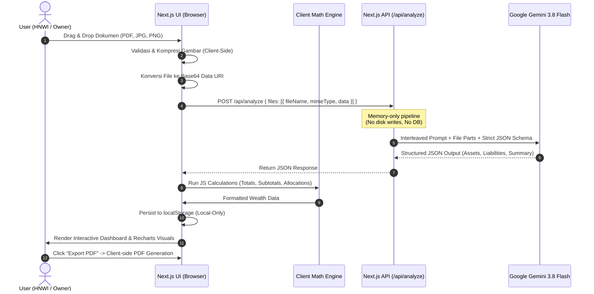

# System Architecture & Privacy-First Flow

## 1. Core Principles

- **Zero Data Collection (Stateless Server):**
  - Tidak ada database (No PostgreSQL, MongoDB, Prisma, Supabase, etc.).
  - File yang diunggah oleh user (screenshot JPG/PNG, dokumen PDF) hanya ditransmisikan dalam format Base64 / in-memory buffer melalui Next.js API Route (`/api/analyze`) langsung ke Google Gemini API.
  - Setelah response AI selesai dikirimkan ke client, server sama sekali tidak menyimpan salinan file maupun hasil ekstraksi di disk atau database.
  
- **Client-Side Storage (Local-First):**
  - Semua data hasil ekstraksi disimpan hanya di browser user (`localStorage`).
  - Pengguna memiliki kontrol penuh: tombol "Hapus Data / Reset" untuk membersihkan seluruh data dari browser secara instan.
  - Privasi data finansial HNWI (High-Net-Worth Individuals) terjamin 100% karena data tidak pernah tersimpan di server pihak ketiga.

- **Deterministic Client-Side Math Engine:**
  - Gemini AI digunakan secara khusus untuk *ekstraksi entitas & normalisasi data dokumen*, bukan untuk kalkulasi penjumlahan atau persentase akhir.
  - Seluruh total kekayaan (*Net Worth*), agregasi per kategori, dan persentase alokasi dihitung secara deterministik oleh JavaScript di browser untuk mencegah halusinasi matematika AI.

---

## 2. End-to-End Data Pipeline



---

## 3. Component Architecture

```
src/
├── app/
│   ├── api/
│   │   └── analyze/
│   │       └── route.ts         # Stateless endpoint to Gemini SDK
│   ├── layout.tsx              # Root layout with font, theme provider
│   ├── page.tsx                # Main entry: Upload & Wealth Dashboard
│   └── globals.css             # Tailwind CSS tokens & aesthetics
├── components/
│   ├── upload/
│   │   ├── dropzone.tsx        # Drag & drop area for multi-format files
│   │   └── file-preview-list.tsx# List of uploaded documents before analyze
│   ├── dashboard/
│   │   ├── net-worth-card.tsx  # Hero total net worth & growth indicator
│   │   ├── executive-summary.tsx# Clean AI commentary & financial highlights
│   │   ├── asset-chart.tsx     # Recharts donut chart with interactive hover
│   │   ├── category-grid.tsx   # Asset cards (Saham, Crypto, Properti, etc.)
│   │   └── asset-detail-modal.tsx # Drill-down itemized list + source_file badge
│   ├── export/
│   │   └── pdf-report-template.tsx # Clean printable format for PDF export
│   └── ui/                     # Shadcn UI primitives (Button, Card, Dialog, etc.)
├── lib/
│   ├── gemini.ts               # Google Gen AI client initializer
│   ├── schema.ts               # Gemini Structured Output Schema & Zod types
│   ├── math.ts                 # Pure calculation functions (totals, percentages)
│   ├── formatters.ts           # IDR Currency, date & number formatters
│   └── storage.ts              # LocalStorage helpers with type safety
└── types/
    └── wealth.ts               # Complete TypeScript interfaces
```
